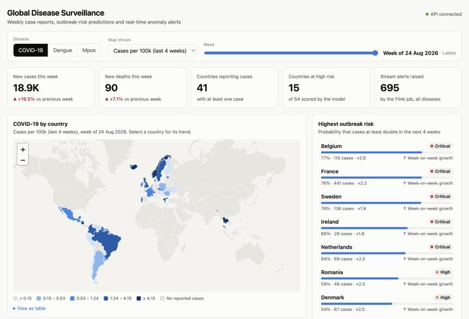
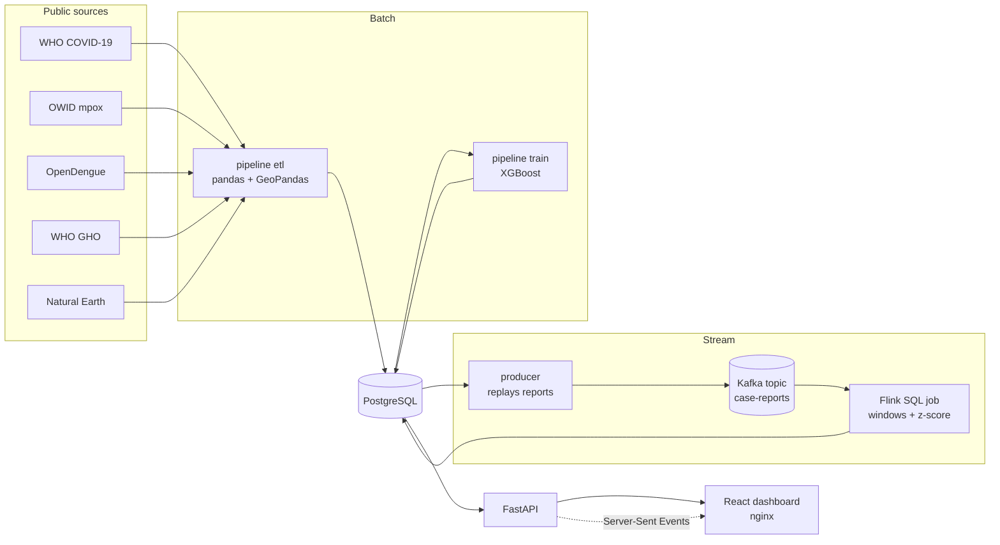
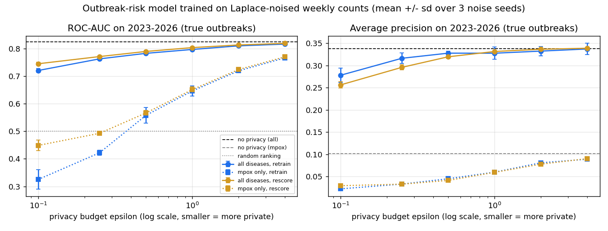
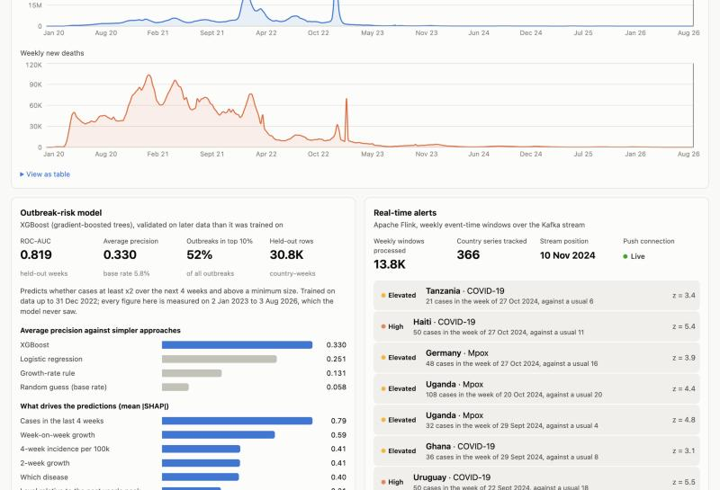

# Global Disease Surveillance & Outbreak Analytics Platform

A full-stack platform that brings public disease datasets into one PostgreSQL database,
serves them through a FastAPI REST API, predicts outbreak risk with XGBoost, detects
anomalies in real time with Apache Flink, and presents everything in an interactive React
map dashboard. Every service is containerised and ships with Kubernetes manifests and an
Azure (AKS) deployment script.

**Stack:** Python · FastAPI · React · PostgreSQL · GeoPandas · XGBoost · Apache Flink ·
Kafka API (Redpanda) · Docker · Kubernetes · Azure



## What it does

| Capability | How |
|---|---|
| **Integrates public data** | Weekly COVID-19 (WHO), mpox (WHO via Our World in Data) and dengue (OpenDengue) counts for 235 countries and territories, plus annual cholera and measles totals (WHO GHO). 119,423 disease-country-weeks, of which 90,492 were reported (the rest are weeks a country did not report, kept as gaps). |
| **Geospatial layer** | GeoPandas builds the country reference table from Natural Earth: ISO codes, population, simplified map geometry and a neighbour graph used as model features. |
| **REST API** | 16 FastAPI endpoints: time series, map snapshots, country profiles, risk scores, model card, alerts, and a Server-Sent Events stream. OpenAPI docs at `/api/v1/docs`. |
| **Outbreak-risk model** | XGBoost estimates, for every country and week, the probability that cases at least double over the next four weeks. Each score comes with its main SHAP drivers. |
| **Real-time processing** | A Flink SQL job reads case-report events from Kafka, aggregates them in event-time weekly windows, compares each week with a rolling eight-week baseline and writes alerts to PostgreSQL. |
| **Dashboard** | React + Leaflet choropleth, risk ranking, country drill-down with model back-test, model card and a live alert feed. Light and dark themes. |
| **Differential privacy** | `python -m pipeline dp-release` publishes the weekly counts with Laplace noise; `dp-eval` measures what each privacy budget ε costs the outbreak model. |
| **API security** | API keys on every data route (probes stay open), per-key rate limiting, dependency (pip-audit) and image (Trivy) scanning in CI. |
| **Operations** | Docker Compose for local use; Kustomize base with local and AKS overlays; `infra/azure/deploy.sh`; GitHub Actions CI. |

## Status

| Capability | State |
|---|---|
| ETL, PostgreSQL, 16 endpoints, dashboard, XGBoost with leakage tests | Implemented and tested (55 backend tests) |
| Provenance sidecars, source catalogue, evaluation report | Implemented and run on the local database |
| DP release with budget ledger, accuracy cost per ε | Implemented and tested; an experiment on public aggregates |
| API keys, rate limiting, pip-audit and Trivy in CI | Implemented and unit-tested; CI scans not yet run on GitHub |
| Flink SQL anomaly job | Implemented; reconciled against batch totals in earlier local runs (not re-run in this update) |
| Kubernetes | Tested on a local cluster; NetworkPolicy enforcement not tested |
| AKS | Script with a dry-run `plan` mode; never applied to a subscription |

Details and open items are in [`PLAN.md`](PLAN.md).

## Architecture



## Run it

Requirements: Docker with about 4 GB of memory available to it.

```bash
docker compose up --build
```

| URL | What |
|---|---|
| http://localhost:8080 | Dashboard |
| http://localhost:8000/api/v1/docs | API documentation (Swagger UI); click **Authorize** and enter the API key |
| http://localhost:8081 | Flink web UI |

On first start the `pipeline` container downloads the datasets (about 25 MB), loads
PostgreSQL and trains the model; this takes three to four minutes. The API and dashboard
start once it finishes. The `producer` then replays reports from 2023 onwards into Kafka at
one week every two seconds, and alerts begin to appear in the dashboard after roughly 20 seconds.

The API key defaults to `local-dev-key`; set `API_KEY` in `.env` to change it (see `.env.example`).

Stop with `docker compose down` (add `-v` to delete the data volumes too). The broker keeps
no volume, so the next `docker compose up` starts an empty topic and replays from the
beginning. If the topic already holds a replay, the producer leaves the stream untouched.

### Without Docker

```bash
# backend (needs a local PostgreSQL)
cd backend
python -m venv .venv && source .venv/bin/activate
pip install -r requirements-dev.txt
python -m pipeline all                  # ETL + model training
API_KEYS=dev-key uvicorn app.main:app --reload    # http://localhost:8000/api/v1/docs
pytest                                  # 55 tests

# frontend
cd frontend
npm install
API_KEY=dev-key npm run dev             # http://localhost:5173, proxies /api to :8000 and adds the key
```

`DATABASE_URL` selects the database (default `postgresql+psycopg2://localhost:5432/disease_surveillance`).

## Data pipeline

`python -m pipeline etl` downloads each source once (cached), normalises it to one row per
disease, country and ISO week, and upserts into PostgreSQL with `COPY` + `ON CONFLICT`.

| Source | Content | Licence |
|---|---|---|
| [WHO COVID-19 dashboard](https://data.who.int/dashboards/covid19) | Weekly cases and deaths, 2020 onwards | CC BY 4.0 |
| [Our World in Data mpox](https://ourworldindata.org/mpox) | Daily cases and deaths, summed to weeks | CC BY 4.0 |
| [OpenDengue v1.3](https://opendengue.org) | Weekly national dengue cases | CC BY 4.0 |
| [WHO Global Health Observatory](https://www.who.int/data/gho) | Annual cholera and measles cases | CC BY-NC-SA 3.0 IGO |
| [Natural Earth](https://www.naturalearthdata.com) | 1:50m country boundaries, population | Public domain |

Details worth knowing:

- Each source defines a week differently (WHO dates a week by its closing Sunday,
  OpenDengue uses Sunday-to-Saturday weeks, mpox is daily). All are mapped to ISO weeks
  starting on Monday.
- Weeks a country did not report are kept and flagged `reported = false` so they are never
  mistaken for zero cases.
- Reporting trails off unevenly at the end of each series. The "latest week" shown for a
  disease is the last week in which at least half of the recent peak number of countries reported.

- One row of `case_reports` is one disease, one country and one ISO week. Of the 119,423 rows,
  90,492 are reported weeks; the other 28,931 are COVID-19 weeks a country skipped. Row counts at
  each stage (reported, with features, labelled) are in `docs/model/model_report.md`.
- OpenDengue sometimes has more than one weekly record for a country-week; the largest is kept,
  never the sum. Its extract has no deaths, which are stored as 0 (see `PLAN.md`).

**Provenance.** Every download writes a sidecar file with the URL, size, SHA-256 and retrieval
time. `python -m pipeline manifest` turns these, together with the rows each source contributed,
into [`docs/data/sources.md`](docs/data/sources.md). Sources are revised: a fresh download of the
WHO COVID-19 file on 22 October 2026 had 702 more country-weeks and 250 revised counts than the
copy the database was loaded from (the mpox and dengue files were identical). Reports therefore
record a hash of the database contents they were computed from.

The schema is in `backend/sql/schema.sql`: `countries`, `country_neighbours`, `diseases`,
`case_reports`, `annual_indicators`, `model_runs`, `risk_scores`, `stream_weekly_counts`,
`stream_alerts`, `dp_release_runs`, and the views `v_weekly_incidence`, `v_global_weekly`, `v_active_run`.

## Outbreak-risk model

**Question.** At the end of each week, for each country and disease: will cases over the
next four weeks be at least double the last four weeks, and reach a meaningful size?

**Features (28).** Recent level and incidence, growth over one, two and four weeks and its
acceleration, deviation from a 12-week baseline, position relative to the past year's peak,
what happened at the same point last year, reporting completeness, the situation in
neighbouring countries and the wider subregion, global trend, season and latitude.

**No look-ahead.** Every feature uses data up to the scoring week only. A unit test changes
future values and asserts that earlier feature rows stay identical.

**Out-of-time validation.** The model is trained on anchor weeks whose four-week outcome ends
by 31 December 2022. Early stopping and the decision threshold use the last 26 of those weeks,
and the fit stops four weeks before them, so no training label looks into the validation weeks.
The test set is the 30,765 anchor weeks from 2 January 2023 to 3 August 2026, with outcomes
followed up to 6 September 2026. Another 3,289 anchor rows in that window have features but no
complete four-week outcome (the last weeks of data, or reporting gaps); they are excluded, never
counted as negative.

| Held-out performance | ROC-AUC | Average precision |
|---|---|---|
| **XGBoost** | **0.82** | **0.34** |
| Logistic regression (same features) | 0.75 | 0.25 |
| Growth-rate rule (rank by 4-week growth) | 0.70 | 0.13 |
| Base rate | – | 0.058 |

The 10% of country-weeks with the highest scores contain 52% of all outbreaks. At the threshold
chosen on the validation weeks (0.45), XGBoost has precision 0.33, recall 0.47, specificity 0.94
and F1 0.39 on the test set; logistic regression at its own threshold has F1 0.33.

| By disease | Country-weeks | Outbreaks | ROC-AUC | Average precision |
|---|---|---|---|---|
| COVID-19 | 16,779 | 1,221 | 0.89 | 0.43 |
| Dengue | 2,930 | 222 | 0.90 | 0.46 |
| Mpox | 11,056 | 351 | 0.82 | 0.10 |

Re-training before each year and testing on that year gives ROC-AUC between 0.82 and 0.92
(2021 to 2025), so performance does not depend on one lucky split.

`python -m pipeline report` reproduces every number here without touching the database and
writes [`docs/model/model_report.md`](docs/model/model_report.md), with confusion matrices,
Brier scores, coverage per stage, the dataset hash and library versions.

Honest caveats:

- Mpox is the weak spot. Counts are small and outbreaks begin abruptly, so the model ranks
  them reasonably (ROC-AUC 0.81) but with low precision.
- The target is a surge in *reported* cases. Changes in testing or reporting practice look
  the same as real surges.
- Exact figures move by a point or two between platforms because of XGBoost's histogram
  construction. The numbers above are from an Apple M1 (`docs/model/model_report.md`).
- The 0.82 and 0.75 ROC-AUC values were measured, not targets the model was tuned towards; the
  test set was used only once the configuration was fixed.

Scores are stored for every week after the training cut-off, together with what actually
happened once known, so the dashboard shows a genuine back-test.

## Differential privacy for the weekly counts

The platform republishes counts that WHO, OWID and OpenDengue already publish, so it does
not hold anyone's medical record. The question here is a narrower one: if a health ministry
gave us its *raw* weekly counts and we wanted to publish them, could someone use the
published table to learn whether a particular person was a case? Small counts are where this
matters. Half of all mpox country-weeks with any cases have five or fewer, and 62% have
between 1 and 9. If a small country goes from 0 to 1 case in a given week, and people locally
know who travelled, the published "1" can identify that person.

`backend/pipeline/privacy.py` releases the table with the **Laplace mechanism**:

- **Unit of privacy: one reported case.** One case is counted in exactly one cell (disease,
  country, week). Removing it changes `new_cases` in that cell by 1 and, if the person died,
  `new_deaths` by 1. That is the whole effect, so the **sensitivity is 2** (L1).
- **Noise:** each reported cell gets Laplace noise with scale `2 / ε` added to both columns.
  At ε = 1 that is a standard deviation of about 2.8 cases.
- **The whole table costs ε once.** Different cells hold different people, so the noise on
  ~119,000 cells does not add up (parallel composition).
- **Rounding to whole numbers and clipping at zero** happen after the noise and cost no extra
  privacy (post-processing).
- **A budget ledger for repeated releases.** `python -m pipeline dp-release --epsilon 0.5`
  writes one noisy CSV plus a metadata file and records the release in `dp_release_runs`. Each
  new release of the same counts adds its ε (and δ) to the total (sequential composition), and a
  release that would take the total over `DP_TOTAL_EPSILON` (default 2) is refused before any
  noise is drawn. Serving fresh noise on every API request would let a caller average it away.
- **Secure randomness.** Real releases draw noise from the operating system's cryptographic
  generator (`secrets.SystemRandom`). Seeded NumPy noise is used only by experiments and tests.
- A Gaussian mechanism (classic `(ε, δ)` bound, valid for ε < 1) is included for comparison.

The tests check the noise scale and the post-processing. They also check the definition of DP
directly: they release two tables that differ by one case who died 400,000 times each, and
check that no output is more than e^ε times likelier under one table than under the other.
The check passes at the correct noise and fails if the noise is halved.

### What it costs the outbreak model

`python -m pipeline dp-eval` releases the counts at ε = 0.1, 0.25, 0.5, 1, 2 and 4 (three noise
draws each), rebuilds the features, retrains XGBoost **only from the noisy release** (features,
training labels and early stopping all come from it), and scores it against the *true* outbreaks
on the same 30,765 test anchors (1,794 outbreaks, 351 of them mpox) as above. Each ε is a
separate hypothetical release, so the grid is not one combined budget. Results and the full
experiment description (privacy unit, adjacency, sensitivity, split) are in `docs/dp/`.

| ε | ROC-AUC (all) | Average precision (all) | Mpox ROC-AUC | Mpox average precision |
|---|---|---|---|---|
| no privacy | **0.82** | **0.34** | **0.82** | **0.10** |
| 4 | 0.82 | 0.34 | 0.78 | 0.10 |
| 2 | 0.82 | 0.34 | 0.75 | 0.09 |
| 1 | 0.80 | 0.33 | 0.67 | 0.06 |
| 0.5 | 0.78 | 0.32 | 0.57 | 0.05 |
| 0.25 | 0.76 | 0.30 | 0.41 | 0.03 |
| 0.1 | 0.72 | 0.29 | 0.36 | 0.02 |

Mean of three noise seeds; standard deviations are at most 0.005 for the all-disease ROC-AUC and
0.04 for mpox (`docs/dp/dp_summary.csv`). The mpox base rate is 0.03.



What this shows:

- **Overall, privacy is cheap.** At ε = 1 the model loses about 0.03 ROC-AUC. Even at ε = 0.5
  it still beats the non-private logistic regression (0.75). COVID-19 and dengue counts are in
  the hundreds, so noise of a few cases hardly changes them.
- **Mpox pays almost all of the cost.** Its ROC-AUC falls from 0.82 to 0.67 at ε = 1, and at
  ε = 0.25 and below it is worse than random. Noise of ±20 cases buries weeks that really had 0 to 5
  cases, and about 38% of true zero weeks are published as non-zero at ε = 1
  (`docs/dp/count_error.json`). The overall score hides this because mpox outbreaks are a
  small share of all outbreaks. The rare diseases that most need privacy are also the ones
  that lose the most usefulness.
- **Rescoring vs retraining.** Feeding noisy features to the existing model gives almost the
  same numbers (`mode = rescore` in the CSV). That model was trained on the true counts,
  though, so only the retrained numbers in the table are private end to end.

Limitations, stated plainly:

- The guarantee is per *case report*. Someone reported k times (for example, COVID-19
  reinfections) is protected at k·ε.
- The shape of the table is treated as public: which country-weeks exist and the `reported`
  flag. A series that starts in the week of a country's first mpox case therefore reveals that
  week. A production release would fix the grid of countries and weeks in advance.
- The noise is continuous and computed in floating point. A production release should use a
  vetted library with discrete or snapping noise (OpenDP, Google's DP library), because naive
  floating-point Laplace noise can leak information (Mironov, 2012), whatever the random source.
- The ledger uses basic composition (sum of ε). Tighter accounting exists but is not needed to
  keep the total honest.
- Noise was added to aggregate counts that are already public. That does not make the source
  data private and is not a patient-level guarantee. It is an experimental study of what a
  release of non-public counts would cost.

## Real-time processing

Public surveillance data is published weekly, so there is no live feed to subscribe to.
`backend/stream/producer.py` simulates one: it splits the stored weekly counts into daily
report events and publishes them to Kafka in calendar order at accelerated speed. The Flink
job treats the topic exactly as it would a live source.

`flink/sql/outbreak_detection.sql`:

1. **Source** – Kafka topic `case-reports`, JSON, event-time watermark seven days behind.
2. **Weekly windows** – 7-day event-time tumbling windows, one per ISO week, disease and country.
3. **Rolling baseline** – an `OVER` window over the previous eight weeks gives the mean and
   standard deviation, excluding the current week.
4. **Alert rule** – at least 20 cases, at least double the baseline mean, and a z-score of 3
   or more, with a Poisson floor so that small counts need a proportionally larger jump.
5. **Sinks** – JDBC upserts into `stream_weekly_counts` and `stream_alerts`.

The API pushes new alerts to the browser over Server-Sent Events (`/api/v1/alerts/stream`).

**Checked against the batch data.** The stream and the batch ETL count the same reports by
independent routes, so after a full replay their weekly totals must agree.
`flink/sql/reconcile.sql` compares them: all 407 disease-weeks match exactly, across repeated
replays at different speeds.

That check caught a real bug. Aligning the windows to Monday with `TUMBLE`'s offset argument
silently dropped three to five whole weeks per replay, with no error and no late-record
metric. Flink's window operator buffers rows in memory and only flushes them when the
watermark crosses an epoch-aligned boundary, ignoring the offset, so a watermark landing
between the two boundaries marks a window as fired before its rows reach state. The job now
shifts event time by three days instead, which makes ISO weeks coincide with Flink's
epoch-aligned windows and needs no offset.



## API

| Endpoint | Returns |
|---|---|
| `GET /health`, `GET /ready` | Liveness and readiness (used by the Kubernetes probes) |
| `GET /diseases` | Diseases, sources, coverage |
| `GET /summary?disease=` | Headline figures for the latest week |
| `GET /cases/global?disease=` | Worldwide weekly series |
| `GET /cases/timeseries?disease=&iso3=` | One country's weekly series |
| `GET /cases/map?disease=&week=` | Per-country snapshot for the map |
| `GET /geo/countries` | Country polygons (GeoJSON) |
| `GET /countries/{iso3}` | Country profile, neighbours, per-disease status |
| `GET /annual?indicator=&iso3=` | Annual cholera or measles totals |
| `GET /risk/scores?disease=&week=&min_level=` | Ranked outbreak-risk scores with SHAP drivers |
| `GET /risk/history?disease=&iso3=` | Risk over time with outcomes |
| `GET /risk/model` | Model card: metrics, feature importance |
| `GET /alerts`, `GET /alerts/stream` | Flink alerts (list and live stream) |
| `GET /stream/status` | How much the streaming job has processed |

All paths are under `/api/v1`.

### Authentication and rate limiting

- Every route except `/health` and `/ready` requires an `X-API-Key` header. The probes stay
  open because Kubernetes and load balancers call them without credentials. The OpenAPI docs
  stay open and show an **Authorize** button.
- Accepted keys come from `API_KEYS` (comma-separated) and are compared in constant time
  (`secrets.compare_digest`). If no keys are configured, every request is refused.
- Each key may make `RATE_LIMIT_PER_MINUTE` requests (default 300) per 60-second window.
  After that it gets `429` with a `Retry-After` header.
- The dashboard's nginx adds its own key on the server side, so the key never reaches the
  browser. Because all browsers share that key, nginx also limits each client IP
  (10 requests a second, bursts of 40).
- In Kubernetes the keys live in the `surveillance-api` Secret. The local overlay generates a
  development key, and `deploy.sh` generates a random key on AKS.

```bash
curl -H "X-API-Key: local-dev-key" "http://localhost:8000/api/v1/risk/scores?disease=covid19"
```

Limitations: the counters are kept in memory in each process, so with N API pods the effective
limit is N times higher. A shared store such as Redis would fix that. The data is public, so
the keys are for knowing who is calling, revoking a client and limiting abuse, not for secrecy.

## Kubernetes and Azure

```
k8s/base/                 namespace, config, PostgreSQL and Redpanda StatefulSets, API (HPA + PDB),
                          dashboard + Ingress, Flink session cluster, pipeline Job + weekly CronJob,
                          Flink job-submit Job, replay Job, NetworkPolicy for the database
k8s/overlays/local/       single replicas, LoadBalancer on localhost:8080, development secret
k8s/overlays/azure/       ACR images, managed-csi storage, AKS application-routing ingress
infra/azure/deploy.sh     resource group -> ACR -> AKS -> build images -> secret -> apply -> wait
infra/azure/teardown.sh   deletes the resource group
```

Local cluster (Docker Desktop Kubernetes, kind or minikube), after `docker compose build`.
This path is tested: all workloads start, the jobs complete and the stream reconciles.
The autoscaler stays idle locally because Docker Desktop ships no metrics server; AKS does.

```bash
kubectl apply -k k8s/overlays/local
kubectl -n surveillance get pods -w
# dashboard on http://localhost:8080 once the pipeline job has completed
kubectl delete -k k8s/overlays/local
```

Azure:

```bash
az login
./infra/azure/deploy.sh        # plan (default): renders manifests, lists what would be created, needs no login
./infra/azure/deploy.sh apply  # creates billable resources, after a confirmation prompt
./infra/azure/teardown.sh      # removes everything
```

The script creates a two-node `Standard_B2ms` AKS cluster and a Basic container registry,
builds the three images in ACR, generates a random database password into a Kubernetes
Secret and prints the public address. Run the teardown script when you are done, since the
cluster is billed by the hour.

The Azure overlay renders and differs from the tested local one only in image names, storage
class and ingress class, but the script itself has not yet been run against a subscription.

## Tests and CI

| Suite | Covers |
|---|---|
| `backend/tests/test_transform.py` | Source normalisation: week alignment, Namibia's `NA` code, negative corrections, partial weeks |
| `backend/tests/test_features.py` | Label definition, no look-ahead, reporting gaps, neighbour features |
| `backend/tests/test_api.py` | Every endpoint against a seeded PostgreSQL database |
| `backend/tests/test_privacy.py` | Laplace/Gaussian noise scale, post-processing, an empirical check of the ε bound |
| `backend/tests/test_security.py` | Open probes, 401 without or with a wrong key, 429 and window reset of the rate limiter |
| `frontend/src/*.test.ts` | Formatting and choropleth class breaks |
| `flink/sql/reconcile.sql` | Stream totals against batch totals after a replay |

`.github/workflows/ci.yml` runs linting and tests for both halves against a PostgreSQL
service container, audits `requirements.txt` with **pip-audit**, builds the images, scans them
with **Trivy** (failing on fixable HIGH or CRITICAL issues) and renders the Kubernetes manifests.
The Trivy action is pinned to a commit hash rather than a tag, because its tags were hijacked
in March 2026 (CVE-2026-33634).

## Project layout

```
backend/
  app/            FastAPI application (routers: meta, geo, cases, risk, alerts; security)
  pipeline/       sources, transform, geo, load, etl, features, model, report, manifest,
                  privacy, dp_release, dp_eval
  stream/         Kafka replay producer
  sql/            schema
  tests/
docs/data/        source catalogue with checksums
docs/model/       evaluation report
docs/dp/          differential-privacy results (CSV, JSON, plot)
PLAN.md           status of every capability and what is still open
knowledge.md      design notes and the reasoning behind them
flink/            Flink image, SQL job, submit script, reconciliation query
frontend/         React + TypeScript dashboard (Vite), nginx config
k8s/              Kustomize base and overlays
infra/azure/      AKS deployment scripts
```
